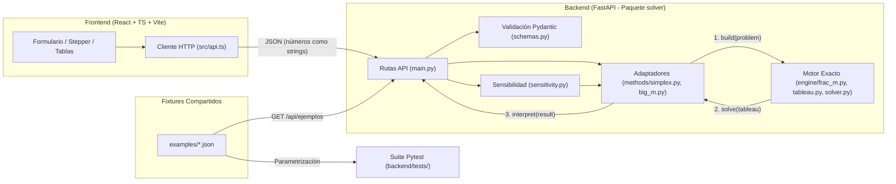

# Contexto Técnico y Funcional del Proyecto — `io1-solver`

> **Proyecto:** Solver de Programación Lineal (Métodos Simplex y Gran M)  
> **Asignatura:** Investigación de Operaciones 1 — Grupo 3  
> **Stack:** FastAPI (Python 3.13 + `uv`) · React 19 + TypeScript + Tailwind CSS v4 (Vite) · Docker & Nginx

---

## 1. Propósito y Reglas Fundamentales

**`io1-solver`** es una aplicación web diseñada para formular, resolver paso a paso, comparar y realizar análisis de sensibilidad sobre problemas de **Programación Lineal (PL)** de hasta **8 variables de decisión y 13 restricciones**, empleando los métodos **Simplex estándar** y **Gran M**.

El diseño arquitectónico responde directamente a las restricciones académicas del curso:
1. **Cero librerías externas de optimización:** Prohibido usar `scipy`, `pulp`, `ortools` o similares. Todo el motor algebraico está construido desde cero en [`backend/src/solver/engine/`](backend/src/solver/engine/) usando únicamente la librería estándar de Python (`fractions.Fraction` y `decimal.Decimal`).
2. **Datos nunca quemados en el código:** Ningún modelo matemático reside dentro del código fuente. Todo problema entra dinámicamente por la interfaz/API o se carga desde archivos JSON externos en [`examples/`](examples/).
3. **Aritmética 100% exacta y simbólica:** No se utilizan números de punto flotante (`float`) en los cálculos. Las entradas viajan como cadenas decimales (`"0.8"`, `"-40"`), se convierten mediante `Fraction(Decimal(s))` y se operan simbólicamente con `FracM` ($a + bM$).
4. **Trazabilidad pedagógica paso a paso:** El sistema retorna cada iteración (snapshot del tableau, variable que entra, variable que sale, elemento pivote, razones mínimas y empates) junto con la detección explícita de casos especiales y resultados acompañados de sus nombres y unidades reales.

---

## 2. Arquitectura del Sistema y Flujo de Datos

El proyecto separa estrictamente la **interfaz de usuario**, la **capa de transporte/validación**, los **adaptadores de cada método** y el **motor algebraico genérico**.



### Estructura de Directorios

```text
io1-solver/
├── .github/workflows/ci.yml      # Pipeline CI: guard-main-base, pytest (uv) y vite build
├── docker-compose.yml            # Orquestación de contenedores (backend :8000, frontend :5173)
├── docs/
│   └── contracts.md              # Fuente de verdad de los contratos internos y de API
├── examples/                     # Fixtures JSON dobles (alimentan la UI y los tests de pytest)
│   ├── bakery-real.json          # Caso real del grupo (plan de producción panadería)
│   ├── test-infeasible.json      # Caso infactible (x1 <= 2 y x1 >= 5)
│   └── test-unbounded.json       # Caso no acotado (max x1 + x2 s.a. x1 - x2 <= 2)
├── backend/                      # Paquete Python `solver` gestionado con `uv`
│   ├── pyproject.toml            # Configuración Python >=3.13, FastAPI, Uvicorn, Pytest
│   ├── src/solver/
│   │   ├── main.py               # Endpoints FastAPI y montaje estático de frontend/dist
│   │   ├── schemas.py            # Modelos Pydantic y validaciones de entrada/salida
│   │   ├── sensitivity.py        # Precios sombra, costos reducidos y rangos de optimalidad/factibilidad
│   │   ├── engine/               # Núcleo matemático agnóstico al método
│   │   │   ├── frac_m.py         # Aritmética exacta a + b*M y orden lexicográfico
│   │   │   ├── tableau.py        # Estructura inmutable del Tableau y pivoteo Gauss-Jordan
│   │   │   └── solver.py         # Bucle iterativo general de resolución
│   │   └── methods/              # Adaptadores por método (Protocolo común `Method`)
│   │       ├── base.py           # Protocolo Method y excepción MethodNotAdmissibleError
│   │       ├── simplex.py        # Constructor e intérprete para Simplex estándar (solo <=, rhs >= 0)
│   │       └── big_m.py          # Constructor e intérprete para Gran M (<=, >=, = con artificiales)
│   └── tests/                    # Pruebas unitarias, de contratos API y parametrizadas con fixtures
└── frontend/                     # SPA en React 19 + TypeScript + Tailwind CSS v4
    ├── src/
    │   ├── types.ts              # Espejo exacto en TypeScript de backend/src/solver/schemas.py
    │   ├── api.ts                # Funciones fetch hacia /api/resolver, /api/sensibilidad, etc.
    │   ├── App.tsx               # Layout principal y navegación por pestañas
    │   └── components/           # MethodTabs, ProblemForm, Stepper, TableauTable
    └── nginx.conf                # Reverse proxy (/api/ -> backend:8000) para despliegue Docker
```

---

## 3. Cómo Funciona el Motor Matemático y los Métodos

### 3.1. Aritmética Simbólica (`FracM` en `engine/frac_m.py`)
Cada celda o costo que involucre la penalización $M$ se representa como una instancia inmutable `FracM(const: Fraction, m: Fraction)`:
$$\text{valor} = \text{const} + \text{m} \cdot M$$
- **Exactitud:** Un string decimal como `"0.1"` se parsea con `Fraction(Decimal("0.1"))`, dando exactamente $\frac{1}{10}$.
- **Orden Lexicográfico Total:** Para comparar dos valores `FracM`, primero se compara el coeficiente `m` (porque $M \to \infty$ domina cualquier constante real) y, solo en caso de empate en `m`, se compara `const`. Así, el motor sabe de forma natural que $-M - 30 < -40$ o que $M + 30 > 40$ sin usar constantes numéricas gigantes (como `1e9`) que causarían errores de redondeo.
- **Formateo Canónico:** Se serializa a texto legible para el usuario (`"5"`, `"3/4"`, `"M"`, `"-M-30"`, `"2M+1/3"`). El frontend jamás recalcula ni convierte a `float`: renderiza el string tal cual.

### 3.2. El Tableau Inmutable (`engine/tableau.py`) y el Bucle (`engine/solver.py`)
El motor (`engine/`) **no sabe qué método se está ejecutando**: recibe un `Tableau` inicial y ejecuta iteraciones hasta alcanzar optimalidad o detectar no acotamiento:
1. **Selección de variable entrante:** Busca la columna que mejora el objetivo según el criterio de optimalidad (usando el orden lexicográfico de `FracM`).
2. **Criterio de parada óptimo:** Si ninguna variable puede mejorar el objetivo, retorna `status = "optimal"`.
3. **Prueba de la razón mínima (variable saliente):** Divide el lado derecho ($\text{RHS} / b_j$) entre los coeficientes estrictamente positivos ($a_{ij} > 0$) de la columna entrante:
   - Si no hay coeficientes positivos en esa columna, el problema es **no acotado** (`status = "unbounded"`).
   - Si hay empate entre dos o más filas en la razón mínima, se registra en `ties` para reportar **pivote degenerado** (`degenerate_pivot`).
4. **Pivoteo de Gauss-Jordan inmutable:** `pivot()` genera una **nueva instancia** de `Tableau` sin mutar las anteriores, permitiendo guardar el historial completo de `Iteration` para el componente `Stepper` del frontend.
5. **Preservación de columnas:** Ninguna columna auxiliar (`s_i`, `e_i`, `a_i`) se elimina durante las iteraciones, ya que la matriz inversa de la base óptima ($B^{-1}$) queda alojada en las columnas de la identidad inicial y es indispensable para el módulo de sensibilidad (`sensitivity.py`).

> [!IMPORTANT]
> **Evolución del formato tabular entre ramas (`v0.1` vs `v0.2` - ADR 0001):**
> - En la rama `main` actual (`v0.1` del scaffold), `docs/contracts.md` describe un `Tableau` con `rows[0]` como fila $z$ unificada ($z_j - c_j$) donde el motor siempre maximiza.
> - En las ramas `origin/develop` y `origin/engine` (`v0.2`, documentado en `docs/adr/0001-formato-tabular-cj-zj.md`), el equipo adoptó el **formato clásico del curso ($C_j - Z_j$)** con filas separadas para coeficientes del objetivo ($C_j$), costos básicos ($C_B$), evaluación ($Z_j = \sum C_{B_i} a_{ij}$) y criterio ($C_j - Z_j$), trabajando directamente en el sentido original (`max` o `min`) sin invertir signos.

### 3.3. Adaptadores de Métodos (`methods/`)
Ambos métodos implementan el protocolo `Method` (`build`, `interpret`, `run`):

| Aspecto | Método Simplex (`methods/simplex.py`) | Método de la Gran M (`methods/big_m.py`) |
|---|---|---|
| **Restricciones admitidas** | Exclusivamente `<=` con `rhs >= 0` (forma estándar). Si recibe `>=`, `=` o `rhs < 0`, lanza `MethodNotAdmissibleError` (HTTP 422 sugiriendo usar Gran M). | Admite `<=`, `>=` y `=`. Si `rhs < 0`, multiplica la restricción por `-1`, invierte el operador y registra el caso especial `normalized_constraint`. |
| **Variables auxiliares** | Agrega variables de holgura $s_i$ (base inicial). | `<=` agrega holgura $s_i$; `>=` agrega exceso $-e_i$ y artificial $+a_i$; `=` agrega artificial $+a_i$. Las artificiales llevan penalización simbólica $\pm M$ en el objetivo. |
| **Detección de Infactibilidad** | No aplica (la base inicial de holguras con $\text{RHS} \ge 0$ siempre es factible). | Si al terminar en estado óptimo alguna variable artificial $a_i$ permanece en la base con valor $> 0$, reporta `status = "infeasible"`. (Si queda en base con valor $0$, se reporta como degeneración). |
| **Casos especiales reportados** | `unbounded`, `degenerate_pivot`, `alternative_optima` (variable no básica con costo reducido $0$ en tabla final). | Todos los de Simplex + `infeasible` y `normalized_constraint`. |

### 3.4. Análisis de Sensibilidad (`sensitivity.py`)
Recibe `{method, problem}`, re-resuelve el problema de forma exacta e inspecciona la tabla óptima final para calcular:
- **Precios sombra (`shadow_prices`):** Valor dual de cada restricción, indicando si es activa (`binding`) y una frase de interpretación en español (ej. *"Una hora más de horno aumentaría la utilidad en 5/2"*).
- **Costos reducidos (`reduced_costs`):** Para cada variable de decisión no básica.
- **Rangos de optimalidad (`objective_ranges`):** Intervalo permitido para cada coeficiente $c_j$ sin que cambie la base óptima (soportando `"-inf"` y `"+inf"`).
- **Rangos de factibilidad (`rhs_ranges`):** Intervalo permitido para cada recurso $b_i$ sin que cambie la base óptima.

---

## 4. Contratos de la API REST (`backend/src/solver/main.py`)

Todos los mensajes dirigidos al usuario (errores de validación, detalles de casos especiales y frases de sensibilidad) se entregan en **español**.

| Método y Ruta | Entrada (JSON) | Respuesta | Descripción |
|---|---|---|---|
| `GET /health` | — | `{"status": "ok"}` | Healthcheck del servidor y contenedor Docker. |
| `GET /api/ejemplos` | — | `list[ExampleSummary]` | Lista los problemas predefinidos en `examples/*.json` (`id`, `name`, `description`, `kind`). |
| `GET /api/ejemplos/{id}` | — | `{"problem": Problem}` | Devuelve la definición completa de un ejemplo listo para poblar el formulario (omite el campo `expected` de testing). |
| `POST /api/resolver` | `{"method": "simplex" \| "big_m", "problem": Problem}` | `MethodResult` | Ejecuta el método elegido y devuelve estado, solución con unidades, valor del objetivo, lista de iteraciones (`iterations`), tabla final y `elapsed_ms`. |
| `POST /api/sensibilidad` | `{"method": ..., "problem": Problem}` | `SensitivityReport` | Calcula precios sombra, costos reducidos y rangos de $c_j$ y $b_i$. |
| `POST /api/comparar` | `{"problem": Problem}` | `Comparison` | Ejecuta ambos métodos sobre el mismo problema y compara estado, número de iteraciones, tiempo en ms, dimensiones del tableau y si llegan al mismo valor óptimo. |

### Reglas de Validación de Entrada (`schemas.py` → HTTP 422)
- El problema debe tener nombre no vacío.
- Entre **1 y 8 variables** y entre **1 y 13 restricciones**.
- Nombres de variables únicos y no vacíos; toda restricción debe tener nombre.
- Cantidad de coeficientes en la función objetivo y en cada restricción igual al número de variables.
- Todo número debe cumplir la expresión regular `^-?\d+(\.\d+)?$` (string entero o decimal con punto).

---

## 5. Guía de Uso y Modos de Ejecución

### Ruta A — Ejecución Oficial Unificada (Sin Docker, un solo puerto)
Ideal para sustentación o revisión del docente. Cuando existe la carpeta `frontend/dist`, FastAPI la sirve automáticamente en la raíz `/`:

```powershell
# 1. Compilar el frontend (solo necesario si frontend/dist aún no existe)
cd frontend
npm ci
npm run build
cd ..

# 2. Sincronizar entorno Python con uv y levantar el servidor
cd backend
uv sync
uv run uvicorn solver.main:app
```
- Aplicación completa y API disponibles en: **`http://127.0.0.1:8000`**

### Modo Desarrollo (Dos terminales con Hot-Reload)
Recomendado mientras se programa el frontend o el backend:

- **Terminal 1 (Backend FastAPI en `:8000`):**
  ```powershell
  cd backend
  uv run uvicorn solver.main:app --reload
  ```
- **Terminal 2 (Frontend Vite en `:5173` con proxy automático de `/api` hacia `:8000`):**
  ```powershell
  cd frontend
  npm run dev
  ```

### Ruta B — Ejecución con Docker Compose
Levanta el backend en Python 3.13 y el frontend servido por Nginx (con proxy reverso configurado en [`frontend/nginx.conf`](frontend/nginx.conf)):

```powershell
docker compose up --build
```
- **Frontend UI:** `http://localhost:5173`
- **Healthcheck Backend:** `http://localhost:8000/health`

### Ejecución de Pruebas Automáticas (`pytest`)
```powershell
cd backend
uv run pytest -v
```

---

## 6. Estado Actual del Repositorio y Ramas Git

Al inspeccionar el historial de Git, es importante distinguir qué hay en tu rama local actual (`main`) frente al trabajo ya adelantado por el equipo en las ramas remotas:

| Rama | Commit actual | Estado y Contenido |
|---|---|---|
| **`main` (rama local activa)** | `bd07a9e` | Contiene el **scaffold base**: contratos `v0.1`, esquemas Pydantic (`schemas.py`), endpoints FastAPI (`main.py`), configuración Docker/CI, fixtures JSON (`examples/`) y stubs con `NotImplementedError` en `engine/`, `methods/` y `sensitivity.py`. Pasan 5 tests de contrato API y 8 están en `skip`. |
| **`origin/develop`** | `d697b67` | **Rama de integración.** Ya incluye: <br>• Actualización de contratos a `v0.2` (formato $C_j - Z_j$, ADR 0001).<br>• Documentación consolidada (`GLOSSARY.md`, `docs/plan.md`, `docs/frontend-plan.md`, enunciado del proyecto).<br>• **Frontend completo para resolución (`Feat/frontend #22`):** componentes `ProblemForm`, `ExamplesMenu`, `Stepper`, `IterationStrip`, `TableauTable`, `SolutionSummary`, `SpecialCasesPanel`, `ErrorBanner`, persistencia local en `draft.ts` y validación en cliente (`validation.ts`). |
| **`origin/engine`** | `13a09d3` | **Rama del motor matemático.** Parte desde `develop` e implementa por completo:<br>• `engine/frac_m.py` (aritmética exacta + orden lexicográfico total).<br>• `engine/tableau.py` (pivoteo Gauss-Jordan inmutable, `evaluate()`, criterios `max`/`min`, razón mínima y detección de empates).<br>• `engine/solver.py` (bucle completo de resolución).<br>• **62 pruebas unitarias pasando** (`test_frac_m.py`, `test_tableau.py`, `test_solver.py`, `test_api_contract.py`) y reporte técnico en `docs/results/engine-simplex.md`. |

### ¿Qué falta por implementar / integrar en el proyecto?
1. **Integrar `origin/engine` en `develop`** mediante Pull Request.
2. **Implementar los adaptadores en `backend/src/solver/methods/`:**
   - `simplex.py` (`build` e `interpret` conectando `Problem` con `Tableau` y `solve()`).
   - `big_m.py` (`build` e `interpret` con variables de exceso, artificiales con costo simbólico $\pm M$ y detección de infactibilidad).
3. **Implementar `backend/src/solver/sensitivity.py`** (`analyze()`) y completar la comparación de valores óptimos en `/api/comparar` (`main.py`).
4. **Conectar las vistas de Comparación y Sensibilidad en el Frontend** y reemplazar el placeholder de [`examples/bakery-real.json`](examples/bakery-real.json) con los datos definitivos de la empresa real del grupo.

---

## 7. Flujo de Trabajo del Equipo (GitFlow Simplificado)

- **`main`:** Rama exclusiva de entregas oficiales (etiquetadas con tags `entrega-N`). El job `guard-main-base` de GitHub Actions **bloquea cualquier PR hacia `main` que no provenga de `develop`**.
- **`develop`:** Rama de integración continua donde convergen todas las ramas de funcionalidades.
- **Ciclo de trabajo:**
  1. Actualizar `develop`: `git checkout develop && git pull origin develop`
  2. Crear rama de tarea: `git checkout -b <nombre-rama>`
  3. Desarrollar verificando que `uv run pytest` y `npm run build` pasen sin errores.
  4. Abrir Pull Request hacia **`develop`** (requiere CI en verde y 1 aprobación).
