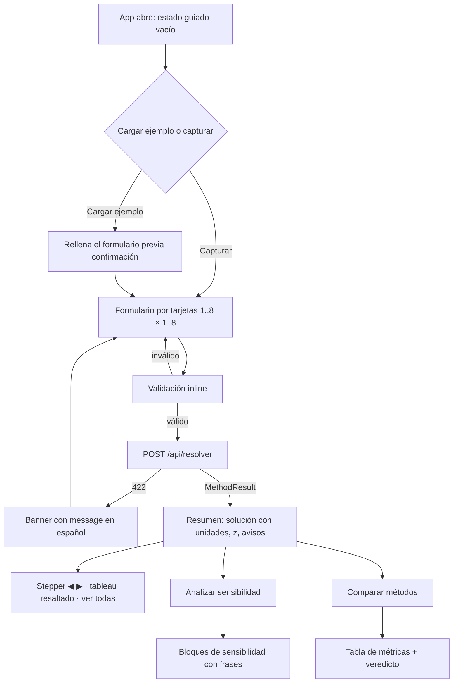

# Plan del frontend — IO1 Grupo 3 (Simplex + Gran M)

Planeación de la interfaz: pantallas, flujo, componentes y su mapeo al
contrato. Fuentes: `docs/PROYECTO FINAL 2026-3.md` (§2, §4, §7),
`docs/plan.md` (arquitectura) y `docs/contracts.md` (contratos exactos).
Este documento sirve como sección "Diseño del sistema (esquema y
pantallas)" del informe de la Entrega 2 (5 %).

Estado del código al planear (`frontend/src/`): existen `types.ts`
(espejo del contrato), `api.ts` (fetch wrappers) y `MethodTabs.tsx`.
`ProblemForm.tsx`, `Stepper.tsx` y `TableauTable.tsx` son stubs con
`TODO`. Todo lo de este plan se construye sobre esos archivos.

## 1. Decisiones (rondas de diseño)

| # | Decisión | Elegido | Alternativas descartadas |
|---|----------|---------|--------------------------|
| F1 | Alcance de esta planeación | Documento de diseño primero; implementación solo tras confirmar el plan | Empezar a codificar sin diseño |
| F2 | Ingreso del problema | Formulario por tarjetas: una tarjeta por variable y por restricción, con nombre y unidad | Matriz tipo hoja de cálculo (rápida, pero sin espacio para validación por campo) |
| F3 | Validación | Inline en el cliente (espejo del contrato) + mensajes 422 del backend mostrados tal cual; nunca se cierra el programa | Solo 422 del servidor |
| F4 | Acabado visual | Diseño conservador con identidad: tokens Tailwind, tablas legibles, resaltado de pivote | Minimal sin estilo propio |
| F5 | Corte por entrega | Entrega 2: Simplex completo. Final: Gran M + sensibilidad + comparación | Adelantar sensibilidad a la Entrega 2 |
| F6 | Flujo de pantallas | Página única: formulario colapsable arriba, resultados abajo | Dos vistas con navegación |
| F7 | Anatomía de cada iteración | Franja de metadatos + tableau clásico: fila $C_j$ superior, columnas fijas $V_B$ y $C_B$ a la izquierda y $b_j$ a la derecha, restricciones en el cuerpo, filas $Z_j$ y $C_j - Z_j$ al pie, columna entrante y fila saliente teñidas, celda pivote marcada | Tabla simple con pie de texto o fila z unificada |
| F8 | Casos especiales | Panel persistente de avisos + badge inline en la iteración donde ocurren | Toasts temporales |
| F9 | Sensibilidad y comparación | Botones en la zona de resultados, sobre el problema cargado | Pestañas independientes con captura propia |
| F10 | Modo demo (sustentación) | Sin modo especial: buenos defaults (dropdown de ejemplos, formulario compacto, contraste alto) | Modo presentación aparte |
| F11 | Ancho del tableau | Scroll horizontal con columnas fijas $V_B$ y $C_B$ a la izquierda y $b_j$ a la derecha; componente agnóstico de dimensiones (renderiza tablas mucho mayores que 8×8) | Encabezados abreviados; transponer la tabla |
| F12 | Sección de sensibilidad | Cuatro bloques temáticos con frases de interpretación destacadas | Una sola tabla ancha |
| F13 | Sección de comparación | Tabla de métricas + banner de veredicto + indicador "mismo z" | Dos tarjetas sin comparativa |
| F14 | Selector de método | Global en el formulario (Simplex \| Gran M); lo usan Resolver y Sensibilidad; Comparar siempre corre ambos | Recordar el método de cada resolución |
| F15 | Estado inicial | Guiado: formulario en blanco + "Cargar ejemplo" (previa confirmación si hay datos escritos) | Auto-cargar el caso real al abrir |

> **Sustituye a `plan.md` Q13/Q16** ("pestañas por método"): las pestañas
> quedan `Resolver | Comparación | Sensibilidad` (como ya declara
> `MethodTabs.tsx`) y el método se elige en el formulario (F14).

**Supuesto explícito de F11:** la entrada de datos sigue limitada a 1..8
variables y 1..13 restricciones (`SIZE_LIMIT` del contrato; el curso pide 8×8,
ampliado a 13 restricciones para el caso real). Lo que escala es el *renderizado*: `TableauTable` no asume
dimensiones y dibuja cualquier R×C. Si algún día se amplía el contrato,
la UI ya no es el cuello de botella.

## 2. Alcance por entrega

| Pantalla / funcionalidad | Entrega 2 (27-oct) | Final (10-nov) |
|---|---|---|
| Formulario por tarjetas (variables, objetivo, restricciones) | ✔ | |
| Selector de método + sentido (max/min) | ✔ (solo Simplex activo) | ✔ (Gran M activo) |
| Validación inline + banner de errores | ✔ | |
| Stepper ◀ ▶ + "ver todas" | ✔ | |
| `TableauTable` con resaltado de pivote | ✔ | |
| Panel de casos especiales + badges | ✔ | |
| Solución con nombres y unidades + z | ✔ | |
| Ejemplos precargados (`/api/ejemplos`) | ✔ | |
| Gran M (mismas pantallas, sin código nuevo de UI) | | ✔ |
| Sección de sensibilidad | | ✔ |
| Sección de comparación | | ✔ |

## 3. Flujo de la aplicación



## 4. Pantallas

Página única, dos zonas: problema (colapsable) y resultados. Así se ve la
pantalla con un problema ya resuelto (wireframe; cifras ilustrativas del
caso `bakery-real`):

```svg
<svg viewBox="0 0 1000 780" font-family="ui-sans-serif, system-ui, sans-serif" font-size="13">
  <!-- header -->
  <text x="24" y="30" font-size="16" font-weight="700" fill="var(--fg)">Solver PL — Simplex · Gran M</text>
  <rect x="560" y="12" width="170" height="28" rx="6" fill="none" stroke="var(--border)"/>
  <text x="572" y="31" fill="var(--muted)">Cargar ejemplo ▾</text>
  <rect x="744" y="12" width="100" height="28" rx="6" fill="var(--accent)" fill-opacity="0.15" stroke="var(--accent)"/>
  <text x="794" y="31" text-anchor="middle" fill="var(--accent)">Simplex</text>
  <rect x="852" y="12" width="100" height="28" rx="6" fill="none" stroke="var(--border)"/>
  <text x="902" y="31" text-anchor="middle" fill="var(--muted)">Gran M</text>

  <!-- form -->
  <rect x="24" y="56" width="952" height="280" rx="8" fill="var(--surface)" stroke="var(--border)"/>
  <text x="40" y="80" font-weight="700" fill="var(--fg)">Problema</text>
  <text x="40" y="104" font-size="12" fill="var(--muted)">Variables (nombre y unidad)</text>
  <rect x="40" y="112" width="200" height="52" rx="6" fill="none" stroke="var(--border)"/>
  <rect x="52" y="120" width="110" height="28" rx="4" fill="none" stroke="var(--border)"/>
  <text x="60" y="139" fill="var(--fg)">pandesal</text>
  <rect x="170" y="120" width="58" height="28" rx="4" fill="none" stroke="var(--border)"/>
  <text x="178" y="139" fill="var(--muted)">lotes</text>
  <rect x="252" y="112" width="200" height="52" rx="6" fill="none" stroke="var(--border)"/>
  <rect x="264" y="120" width="110" height="28" rx="4" fill="none" stroke="var(--border)"/>
  <text x="272" y="139" fill="var(--fg)">hojaldre</text>
  <rect x="382" y="120" width="58" height="28" rx="4" fill="none" stroke="var(--border)"/>
  <text x="390" y="139" fill="var(--muted)">lotes</text>
  <rect x="464" y="120" width="110" height="28" rx="6" fill="none" stroke="var(--border)" stroke-dasharray="4 3"/>
  <text x="519" y="139" text-anchor="middle" fill="var(--muted)">+ variable</text>

  <text x="40" y="192" font-size="12" fill="var(--muted)">Función objetivo</text>
  <rect x="40" y="200" width="64" height="28" rx="4" fill="none" stroke="var(--border)"/>
  <text x="72" y="219" text-anchor="middle" fill="var(--fg)">max</text>
  <rect x="112" y="200" width="330" height="28" rx="4" fill="none" stroke="var(--border)"/>
  <text x="122" y="219" fill="var(--fg)">Z = 40 · pandesal + 30 · hojaldre</text>

  <text x="40" y="252" font-size="12" fill="var(--muted)">Restricciones (nombre, coeficientes, operador, RHS)</text>
  <rect x="40" y="260" width="300" height="48" rx="6" fill="none" stroke="var(--border)"/>
  <text x="52" y="280" fill="var(--fg)">horno</text>
  <text x="52" y="298" fill="var(--muted)">1 · pandesal + 1 · hojaldre ≤ 40</text>
  <rect x="352" y="260" width="330" height="48" rx="6" fill="none" stroke="var(--border)"/>
  <text x="364" y="280" fill="var(--fg)">demanda_hojaldre_min</text>
  <text x="364" y="298" fill="var(--muted)">0 · pandesal + 1 · hojaldre ≥ 5</text>
  <rect x="694" y="264" width="110" height="28" rx="6" fill="none" stroke="var(--border)" stroke-dasharray="4 3"/>
  <text x="749" y="283" text-anchor="middle" fill="var(--muted)">+ restricción</text>

  <rect x="844" y="292" width="116" height="32" rx="6" fill="var(--accent)"/>
  <text x="902" y="313" text-anchor="middle" fill="var(--surface)">Resolver</text>

  <!-- results -->
  <rect x="24" y="352" width="952" height="404" rx="8" fill="var(--surface)" stroke="var(--border)"/>
  <rect x="40" y="368" width="920" height="36" rx="6" fill="var(--success)" fill-opacity="0.12" stroke="var(--success)"/>
  <text x="56" y="391" fill="var(--success)" font-weight="700">Óptimo · Z = 1550 (max)</text>

  <text x="56" y="435" font-size="12" fill="var(--muted)">Solución:</text>
  <rect x="116" y="416" width="190" height="28" rx="6" fill="none" stroke="var(--border)"/>
  <text x="128" y="435" fill="var(--fg)">pandesal = 35 lotes</text>
  <rect x="318" y="416" width="190" height="28" rx="6" fill="none" stroke="var(--border)"/>
  <text x="330" y="435" fill="var(--fg)">hojaldre = 5 lotes</text>

  <rect x="40" y="456" width="920" height="40" rx="6" fill="var(--warning)" fill-opacity="0.12" stroke="var(--warning)"/>
  <text x="56" y="481" fill="var(--warning)">Aviso — empate en razón mínima en la iteración 3 (filas s1, s2): degeneración.</text>

  <rect x="40" y="508" width="920" height="36" rx="6" fill="none" stroke="var(--border)"/>
  <text x="56" y="531" fill="var(--fg)">◀</text>
  <text x="84" y="531" fill="var(--fg)">Iteración 2 de 3</text>
  <text x="220" y="531" fill="var(--muted)">entra: pandesal · sale: s1 · pivote: 1</text>
  <text x="520" y="531" fill="var(--muted)">razón mínima: 35</text>
  <text x="872" y="531" fill="var(--fg)">▶</text>
  <text x="900" y="531" fill="var(--accent)">Ver todas</text>

  <!-- tableau clasico C_j - Z_j -->
  <rect x="220" y="556" width="100" height="200" fill="var(--accent)" fill-opacity="0.10"/>
  <rect x="40" y="656" width="820" height="36" fill="var(--accent)" fill-opacity="0.10"/>
  <rect x="220" y="656" width="100" height="36" fill="none" stroke="var(--accent)" stroke-width="2"/>
  <!-- C_j top row -->
  <line x1="160" y1="556" x2="760" y2="556" stroke="var(--border)"/>
  <text x="180" y="574" font-size="11" fill="var(--muted)">C_j</text>
  <text x="270" y="574" text-anchor="middle" font-size="11" fill="var(--muted)">40</text>
  <text x="370" y="574" text-anchor="middle" font-size="11" fill="var(--muted)">30</text>
  <text x="460" y="574" text-anchor="middle" font-size="11" fill="var(--muted)">0</text>
  <text x="540" y="574" text-anchor="middle" font-size="11" fill="var(--muted)">0</text>
  <text x="620" y="574" text-anchor="middle" font-size="11" fill="var(--muted)">-M</text>
  <text x="710" y="574" text-anchor="middle" font-size="11" fill="var(--muted)">—</text>
  <!-- header line -->
  <line x1="40" y1="586" x2="860" y2="586" stroke="var(--border)"/>
  <text x="65" y="606" font-size="12" font-weight="700" fill="var(--muted)">V_B</text>
  <text x="125" y="606" font-size="12" font-weight="700" fill="var(--muted)">C_B</text>
  <text x="270" y="606" text-anchor="middle" font-size="12" fill="var(--muted)">pandesal</text>
  <text x="370" y="606" text-anchor="middle" font-size="12" fill="var(--muted)">hojaldre</text>
  <text x="460" y="606" text-anchor="middle" font-size="12" fill="var(--muted)">s1</text>
  <text x="540" y="606" text-anchor="middle" font-size="12" fill="var(--muted)">e1</text>
  <text x="620" y="606" text-anchor="middle" font-size="12" fill="var(--muted)">a1</text>
  <text x="710" y="606" text-anchor="middle" font-size="12" font-weight="700" fill="var(--muted)">b_j</text>
  <text x="810" y="606" text-anchor="middle" font-size="12" fill="var(--muted)">razón mín</text>
  <line x1="40" y1="620" x2="860" y2="620" stroke="var(--border)"/>
  <!-- constraint row 1 -->
  <text x="65" y="642" fill="var(--fg)">s1</text>
  <text x="125" y="642" fill="var(--fg)">0</text>
  <text x="270" y="642" text-anchor="middle" fill="var(--fg)">1</text>
  <text x="370" y="642" text-anchor="middle" fill="var(--fg)">1</text>
  <text x="460" y="642" text-anchor="middle" fill="var(--fg)">1</text>
  <text x="540" y="642" text-anchor="middle" fill="var(--fg)">0</text>
  <text x="620" y="642" text-anchor="middle" fill="var(--fg)">0</text>
  <text x="710" y="642" text-anchor="middle" fill="var(--fg)">40</text>
  <text x="810" y="642" text-anchor="middle" fill="var(--fg)">40</text>
  <line x1="40" y1="656" x2="860" y2="656" stroke="var(--border)"/>
  <!-- constraint row 2 (leaving row) -->
  <text x="65" y="678" fill="var(--fg)">a1</text>
  <text x="125" y="678" fill="var(--fg)">-M</text>
  <text x="270" y="678" text-anchor="middle" fill="var(--fg)">0</text>
  <text x="370" y="678" text-anchor="middle" fill="var(--fg)">1</text>
  <text x="460" y="678" text-anchor="middle" fill="var(--fg)">0</text>
  <text x="540" y="678" text-anchor="middle" fill="var(--fg)">-1</text>
  <text x="620" y="678" text-anchor="middle" fill="var(--fg)">1</text>
  <text x="710" y="678" text-anchor="middle" fill="var(--fg)">5</text>
  <text x="810" y="678" text-anchor="middle" font-weight="700" fill="var(--accent)">5</text>
  <line x1="40" y1="692" x2="860" y2="692" stroke="var(--border)"/>
  <!-- Z_j row -->
  <text x="125" y="712" font-weight="700" fill="var(--fg)">Z_j</text>
  <text x="270" y="712" text-anchor="middle" fill="var(--fg)">0</text>
  <text x="370" y="712" text-anchor="middle" fill="var(--fg)">-M</text>
  <text x="460" y="712" text-anchor="middle" fill="var(--fg)">0</text>
  <text x="540" y="712" text-anchor="middle" fill="var(--fg)">M</text>
  <text x="620" y="712" text-anchor="middle" fill="var(--fg)">-M</text>
  <text x="710" y="712" text-anchor="middle" font-weight="700" fill="var(--fg)">-5M</text>
  <text x="810" y="712" text-anchor="middle" fill="var(--muted)">—</text>
  <line x1="40" y1="724" x2="860" y2="724" stroke="var(--border)"/>
  <!-- C_j - Z_j row -->
  <text x="105" y="744" font-weight="700" fill="var(--fg)">C_j−Z_j</text>
  <text x="270" y="744" text-anchor="middle" fill="var(--fg)">40</text>
  <text x="370" y="744" text-anchor="middle" font-weight="700" fill="var(--accent)">M+30</text>
  <text x="460" y="744" text-anchor="middle" fill="var(--fg)">0</text>
  <text x="540" y="744" text-anchor="middle" fill="var(--fg)">-M</text>
  <text x="620" y="744" text-anchor="middle" fill="var(--fg)">0</text>
  <text x="710" y="744" text-anchor="middle" fill="var(--muted)">—</text>
  <text x="810" y="744" text-anchor="middle" fill="var(--muted)">—</text>
  <line x1="40" y1="756" x2="860" y2="756" stroke="var(--border)"/>
  <text x="40" y="772" font-size="11" fill="var(--muted)">Formato clásico C_j − Z_j: el frontend solo muestra strings exactos recibidos de la API, nunca calcula.</text>
</svg>
```

Notas del wireframe:

- Fila $C_j$ arriba, sobre los nombres de variables; fija e independiente del paso.
- Columnas $V_B$ y $C_B$ a la izquierda (`position: sticky`), y $b_j$ a la derecha (`position: sticky`).
- Restricciones en el cuerpo: cada fila muestra su variable básica ($V_B$) y costo ($C_B$).
- Filas inferiores $Z_j$ y $C_j - Z_j$: $Z_j$ en la columna $b_j$ muestra el valor actual de $Z$; $C_j - Z_j$ en $b_j$ queda vacío.
- Columna entrante (`hojaldre`, $C_j - Z_j = M+30$ más positivo en max) y fila saliente (`a1`, menor razón 5) teñidas; celda pivote con borde de acento.
- La columna "razón mín" aparece a la derecha de $b_j$ durante los pasos con razones calculadas.
- En Gran M las celdas muestran `-M-30`, `M+30`, `M-10`, etc., tal cual desde la API.
## 5. Componentes

| Archivo | Responsabilidad | Estado |
|---|---|---|
| `App.tsx` | Página única: estado del problema, método, resultados; formulario colapsable | existe — ampliar |
| `components/MethodTabs.tsx` | Pestañas `Resolver \| Comparación \| Sensibilidad` | existe |
| `components/ProblemForm.tsx` | Formulario por tarjetas (1..8 × 1..8), método y sentido, validación inline | stub — construir |
| `components/ExamplesMenu.tsx` | `GET /api/ejemplos`, rellena el formulario con confirmación | nuevo |
| `components/ErrorBanner.tsx` | 422 del backend y errores de red, en español | nuevo |
| `components/SolutionSummary.tsx` | Solución con nombres y unidades + z en el sentido original | nuevo |
| `components/SpecialCasesPanel.tsx` | Panel persistente de avisos + badge por iteración | nuevo |
| `components/IterationStrip.tsx` | Franja `◀ iteración N · entra · sale · pivote · razones · ▶` | nuevo |
| `components/Stepper.tsx` | Recorrido de iteraciones + "ver todas" (apiladas) | stub — construir |
| `components/TableauTable.tsx` | Tableau genérico R×C, resaltado, scroll + columnas fijas | stub — construir |
| `components/SensitivitySection.tsx` | Cuatro bloques de sensibilidad con frases | nuevo (final) |
| `components/ComparisonSection.tsx` | Tabla de métricas + veredicto | nuevo (final) |
| `api.ts` | Wrappers de fetch por endpoint | existe |
| `types.ts` | Espejo de `docs/contracts.md` en TypeScript | existe |

Sin estado global ni router: `useState` en `App.tsx` y props hacia abajo.
Si el estado compartido crece, un reducer; no antes.

## 6. Especificación por componente

### 6.1 `ProblemForm` (tarjetas)

- Variables: tarjeta con `name` y `unit`; añadir/quitar (1..8). Coeficientes
  del objetivo en la misma columna que su variable.
- Restricciones: tarjeta con `name`, un coeficiente por variable, `op`
  (`≤`/`≥`/`=`) y `rhs`. Añadir/quitar (1..8).
- Selector de método (Simplex | Gran M) y de sentido (max | min), F14.
- Todos los campos numéricos aceptan string decimal (`2.5`, `-40`);
  se muestran como texto, nunca se calcula en el cliente.
- Colapsable tras resolver para dejar ancho a las tablas (F6).

### 6.2 `TableauTable`

- Props: `tableau: TableauData`, `iteration: Iteration`.
- Dimensiones agnósticas: R×C cualquiera; entrada al contrato hasta 8×8,
  pero renderiza tablas mucho mayores sin cambios (F11 y supuesto de §1).
- Disposición clásica:
  - Fila superior $C_j$: muestra los coeficientes del objetivo sobre las columnas de variables.
  - Encabezado: $V_B$ y $C_B$ a la izquierda, nombres de variables al centro, $b_j$ a la derecha, y opcionalmente "razón mín".
  - Cuerpo: una fila por restricción (`rows`), mostrando `basic` ($V_B$), `cb` ($C_B$), y `cells` (incluyendo $b_j$).
  - Pie: fila $Z_j$ (`zj`), con el valor actual de $Z$ en la celda $b_j$; fila $C_j - Z_j$ (`cj_zj`), con celda vacía en $b_j$.
- Scroll horizontal; columnas $V_B$ y $C_B$ fijas a la izquierda y $b_j$ fija a la derecha (`position: sticky`).
- Resaltado: columna entrante y fila saliente teñidas, celda pivote con
  borde, badge en filas con empate (`ties`), columna "razón mín" (solo si `ratios` no está vacía).
- Celdas: strings canónicos tal cual (`"3/4"`, `"-M-30"`). El frontend nunca calcula ni parsea.
### 6.3 `Stepper` + `IterationStrip`

- ◀ ▶ recorre `iterations` (0 = tabla inicial, sin entra/sale) y "ver
  todas" muestra todas las tablas apiladas con sus franjas (F7).

### 6.4 `SpecialCasesPanel`

- Un bloque por `SpecialCase`: tipo, iteración (si tiene) y `detail` ya en
  español. Badge inline en la iteración correspondiente. Persistente: sirve
  de captura para el informe (F8).

### 6.5 `SensitivitySection` (final)

- Cuatro bloques (F12): precios sombra (tarjeta por restricción, marca
  `binding`), costos reducidos (tarjeta por variable), rango de $c_j$ y
  rango de $b_i$ (tablas). Frases de `phrase` destacadas; `"-inf"`/`"+inf"`
  visibles tal cual.

### 6.6 `ComparisonSection` (final)

- Banner con `verdict` + `same_objective`; tabla con una fila por método y
  columnas `status` (badge), iteraciones, `elapsed_ms`, `tableau_shape`.
  `not_admissible` es un badge, no un error (F13).

### 6.7 `ExamplesMenu`

- Lista de `GET /api/ejemplos`; al elegir, `GET /api/ejemplos/{id}` y rellena
  el formulario. Si hay datos escritos, confirmación de sobrescritura (F15).

## 7. Validación

| Regla | Dónde | Mensaje (español) |
|---|---|---|
| Campo vacío | inline | "Completa este campo." |
| Número no parseable | inline | "Escribe un número (ej. 2.5 o -4)." |
| Nombre vacío o duplicado | inline | "Los nombres deben ser únicos y no vacíos." |
| Coeficientes ≠ variables | inline | "Debe haber un coeficiente por variable." |
| Más de 8 variables o 13 restricciones | UI (oculta "+") + backend | `SIZE_LIMIT` |
| Simplex con `≥`, `=` o RHS negativo | backend 422 | `METHOD_NOT_ADMISSIBLE`: se muestra `message` tal cual (sugiere Gran M) |
| Servidor no responde | cliente | "No se pudo contactar al servidor." |

Regla transversal (F3): los errores nunca cierran el programa ni borran lo
capturado; el 422 del backend se muestra sin traducir ni resumir.

## 8. Criterios de aceptación

1. Capturar un PL 2×2 y resolverlo con Simplex: solución con nombres y
   unidades, z en el sentido original, y cada iteración con entra/sale/
   pivote resaltado.
2. Cargar `bakery-real` y resolverlo: coincide con `expected` del fixture.
3. Simplex con `≥`: aparece `METHOD_NOT_ADMISSIBLE` sugiriendo Gran M; los
   datos capturados siguen intactos.
4. `test-infeasible` con Gran M: panel de caso especial con la frase; sin
   crasheo ni pantalla en blanco.
5. Problema no acotado: aviso con la iteración donde se detectó.
6. Campo vacío o no numérico: error inline y no se envía la petición.
7. ◀/▶ recorre todas las iteraciones; "ver todas" las muestra apiladas.
8. Tableau 8×8 con Gran M: scroll horizontal con `Básica` y `RHS` fijas;
   una tabla sintética mayor se renderiza igual (sin scroll roto).
9. Sensibilidad: cuatro bloques con frases; rangos con `-inf`/`+inf` visibles.
10. Comparación: tabla de métricas + veredicto; `not_admissible` como badge.

## 9. Reglas del curso → dónde se cumplen (frontend)

| Regla del PDF | Dónde vive |
|---|---|
| Ingreso de datos con nombres y unidades | `ProblemForm` (tarjetas) |
| Validación con mensajes claros | inline + `ErrorBanner` (§7) |
| Paso a paso: entra, sale, pivote | `IterationStrip` + `TableauTable` |
| Aviso de casos especiales | `SpecialCasesPanel` |
| Resultado con nombres y unidades | `SolutionSummary` |
| Ejemplos precargados | `ExamplesMenu` (`/api/ejemplos`) |
| Visualización clara / capturas del informe | F4: diseño conservador con identidad |
| Textos de UI en español; código en inglés | Convención de `plan.md` |
